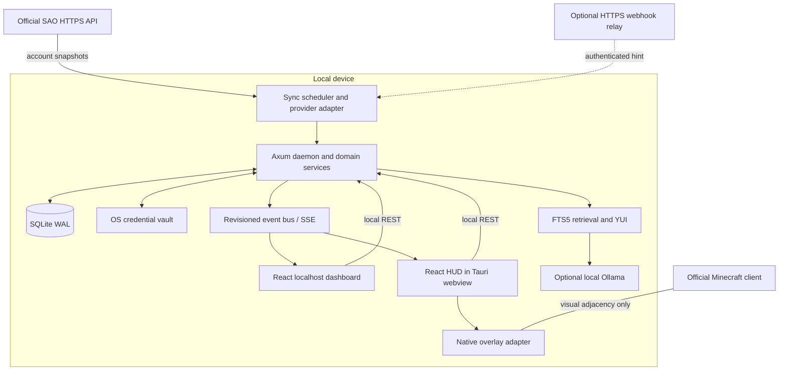

# CARDINAL — System Architecture
Version 1.0 | 2026-11-25 | Normative implementation specification
Related: PRD.md, API.md, Design_Topography.md, Dashboard.md, AGENT.md

## 1. Architectural decisions
Local-first, single user, Rust-owned data, React-owned presentation. One daemon serves compiled frontend and versioned JSON/SSE on 127.0.0.1:7410. No mandatory cloud. Tauri 2 desktop shell is a separate process that can start or attach to daemon and uses a narrowly scoped native bridge. Use stable supported Rust/Node versions, lockfiles and exact dependency resolutions; do not claim a version tested before checking it. Prefer Rust Axum/Tokio/SQLx SQLite/reqwest/serde/tracing, React/TS/Vite/Tailwind/Radix/Motion/Lucide/TanStack Query/Zustand/Recharts. Browser and HUD share React components, API client, schema and design tokens. Use OS credential store via keyring; if unavailable require ephemeral secret entry rather than plaintext persistence. Optional Ollama provider and FTS5 knowledge search. No requirement for vector database at launch.


No data arrow from game process in default mode. Overlay is a normal OS window, not injection or a client mod. Relay is deferred. Native overlay never writes player input.

## 2. Repository structure
```text
/
  PRD.md Architecture.md API.md Design_Topography.md Dashboard.md
  AGENT.md AGENTS.md README.md
  Cargo.toml Cargo.lock rust-toolchain.toml
  package.json pnpm-workspace.yaml pnpm-lock.yaml
  crates/
    domain/             # pure entities, provenance, rules, events
    storage/            # SQLx repositories and migration runner
    sao-provider/       # upstream DTOs, adapter, HTTP, fixtures
    daemon/             # Axum routes, sync loop, static files, auth
    knowledge/          # ingestion, FTS5, citations, build calculators
    yui/                # provider interface and prompt assembly
  apps/
    web/                # React SPA, overview + all routes + HUD preview
    desktop/            # Tauri shell, OS commands, native overlay lifecycle
      src-tauri/
  packages/
    ui/                 # tokens, accessible primitives, HUD widgets
    contracts/          # generated TS types and validation
    client/             # typed fetch, query keys, SSE manager
  migrations/           # forward-only SQL with migration checksums
  knowledge/            # licensed/original curated markdown + manifest
  fixtures/             # synthetic, non-account example responses
  scripts/              # portable developer commands
  tests/                # integration + Playwright suites
  docs/                 # ADRs, manual verification, support matrix
```
For initial vertical slice a single daemon crate may contain internal modules rather than premature crates. Split once boundaries prove useful. Dependencies inward: adapter/storage depend on domain; daemon composes services; domain never depends on transport/storage/UI. Never duplicate business calculations in browser; UI formatting only. Generated contract types are checked in and regenerated on schema changes.

## 3. Services and lifecycle
- Bootstrap: resolve per-user OS app-data paths, create lockfile/IPC single-instance guard, migrate DB, load settings, bind only loopback, initialize session token, start scheduler, then mark ready. Port conflicts fail with readable diagnostics or an explicit chosen alternate; never attach to arbitrary port.
- Provider: allowlisted base URL, TLS validation, connect timeout 5s / total 15s, scoped endpoints only, DTO-to-domain mapping, tolerate unknown fields and nullable optional fields. Demo adapter deterministic, no network.
- Sync orchestrator: one in-flight request per resource; coalesce manual/SSE hints; independent retry/backoff, ETags for supported routes. Scope/auth failures don't erase cached values. Global budget 20 requests/minute target, hard limiter below upstream 60/key and 120/IP. Poll profile/balance 60s, inventory 90s, dungeons 120s, transactions 180s while active; pause/reduce background to 5min when idle. Never poll more often than 30s/resource; use Retry-After.
- Storage: transactional snapshot write plus revision/outbox entry, then publish committed revision. Dedup by snapshot ID/hash where available. Single writer coordination, SQLite WAL, foreign keys enabled, busy timeout 5s. Use bounded read pool.
- Event bus: durable recent event history + bounded live broadcast. Sequence monotonically increases in DB; SSE supports replay and reset when cursor expires. Coalesce rapid UI revalidation. Backpressure drops subscriber, not data; client reconnects.
- Quest service: personal journal only; explicit manual tracking, status, checklists, timestamps. Never claim official progression.
- Knowledge: curated local Markdown, content hashes, versioned sources, FTS5 bm25 + filters; use original summaries, source URLs, review dates, no unlicensed asset ingestion. Optional embeddings later with transparent model/version.
- YUI: query + selected context snapshot -> retrieval -> read-only answer with citations and uncertainty. No tool execution, control of game or system, or ability to access credentials. Disabled without configured provider, direct knowledge search still works.
- Shutdown: stop scheduler, cancel tasks, flush committed writes, close SSE, release instance lock. Desktop close hides HUD or exits based on user setting; daemon can remain running intentionally with visible tray status.

## 4. Core state contract
All domain values with provenance: source = api | manual | demo | approved_observation; observedAt (nullable UTC), fetchedAt, status = fresh | stale | unavailable | unconfigured | scope_denied | error, revision. UI displays source and last seen rather than assigning a timestamp that implies live telemetry. Demo and live stores use separate profile namespaces and switching clears query cache. Session mode is explicit, never merge fixtures into live analytics. Incoming official data is untrusted; validate, cap sizes, escape rendered lore and never render arbitrary HTML. UTC at rest; format locale client-side. Cols integers checked in i64; encode integers that might exceed JS safe range as decimal strings; no floating-point currency. Domain revisions may be decimal strings in JSON.

## 5. SQLite schema (initial migration plan)
| Table | Key fields and constraints |
|---|---|
| profiles | id PK, mode, upstream_uuid nullable unique per mode, display_name, created_at |
| resource_state | profile_id + resource PK, status, observed_at, fetched_at, etag, error_code, revision |
| profile_snapshots | id PK, profile_id FK, observed_at, fetched_at, level, xp, class_name, payload_json, content_hash; indexed time |
| inventory_snapshots | profile_id + snapshot_id PK, observed_at, fetched_at, server, payload_json |
| inventory_items | snapshot composite FK, section_key, slot, item_id, name, amount, damage, max_damage, lore_json; PK snapshot+section+slot |
| balance_snapshots | id PK, profile_id, observed_at, fetched_at, balance INTEGER, currency |
| transactions | profile_id + fingerprint + occurrence PK, at, kind, amount, balance_after, outcome, source_type, source, entries, raw_json |
| dungeon_runs | profile_id + fingerprint + occurrence PK, dungeon, difficulty, success, duration_ms, finished_at, group_size |
| dungeon_records | profile_id + record_key PK, raw_json, fetched_at |
| quests | id UUID PK, profile_id FK, title, description, source_url, status, tracked, updated_at, version |
| quest_steps | id UUID PK, quest_id FK ON DELETE CASCADE, sort_order, title, completed_at |
| notes | id UUID PK, profile_id FK, entity_type, entity_id, body, updated_at |
| settings | profile_id + key PK, value_json, version |
| knowledge_documents | id PK, title, source_url, reviewed_at, game_version, content_hash, license_note, body |
| knowledge_fts | FTS5 external-content index maintained transactionally |
| event_log | revision INTEGER PK AUTOINCREMENT, profile_id, type, payload_json, created_at |
| webhook_deliveries | delivery_id PK, event_type, accepted_at (optional phase) |

Use raw provider payloads only after removing secrets and unexpected sensitive fields; keep a bounded size. For transactions and runs without stable IDs, normalize canonical fields and use occurrence counts within overlapping pages, not blind uniqueness on timestamp. Do not assert perfect historical reconciliation for ambiguous same-timestamp cursor boundaries; expose coverage gaps. Keep 90 days of raw snapshot history by default, daily aggregate retention 365 days, event log 7 days or 10k latest entries, notes/quests until deletion. Transaction and run retention configurable; default 365 days local (upstream offers shorter coverage). Export user-owned JSON; no credentials. Backup via SQLite backup API, restore only after validation and explicit confirmation. Never delete originals during routine migrations.

## 6. Overlay architecture
NativeOverlay trait: capabilities(), show(), hide(), set_mode(), set_bounds(), get_bounds(), subscribe_window_events(). Mode enum hidden/passive/edit/preview. Passive = no focus, click-through; edit = intentional pointer interaction, visible exit affordance and global hide fallback. Always expose tray toggle and accessible browser controls. Window is transparent, undecorated, always-on-top only when requested; keep no taskbar entry where supported. Use a single overlay per selected monitor, DIP coordinates; persist monitor identity + normalized anchors + scale; clamp to available bounds when monitors change. Do not use global keyboard monitoring; use user-assigned OS shortcut only, conflict detection and graceful fallback. Default hotkeys Ctrl+Shift+F9 toggle and Ctrl+Shift+F10 edit (configurable); never intercept normal Minecraft keys. On crash, focus loss, unsupported capabilities or failed click-through, hide/fallback safely. Never cover crosshair, game hotbar, chat or official HUD; allow user safe-area calibration in preview.
Windows: Tauri transparent window + setIgnoreCursorEvents, always-on-top, borderless/windowed compatibility. Do not promise exclusive fullscreen. Track position only using supported OS window geometry if consented; no game handle memory access. If not possible, manual monitor alignment. Linux: X11 test Tauri support; Wayland/Hyprland use optional layer-shell native adapter (GTK4 + supported layer-shell bindings; choose verified versions), non-keyboard-interactive passive surface; manual output anchor. Do not assume cross-compositor focus/click-through. macOS best-effort browser initially; no special OS permissions for baseline. All OS-specific code behind capability flags. Live overlay feature defaults locked until user confirms server operator permission, demo desktop preview permitted away from gameplay. Observation adapter is not implemented without separate written approval and privacy review.

## 7. Frontend architecture
React Router routes, app shell, reusable feature components; TanStack Query owns remote/server cache; Zustand owns ephemeral view layout and filters, not canonical data. Use typed client and Zod/runtime guards at boundaries. Dashboard route /hud-preview uses same HudCanvas as desktop. HUD renders widgets using responsive anchors in CSS, not browser screenshot. SSE invalidates affected query keys; event payloads are hints not authoritative snapshots; a single stream per surface. Reconnect with exponential jitter, reset/refetch on cursor gap. Error boundaries per route and HUD widget. Component stories/fixtures for empty/stale/scope-denied/demo/error/loading. Browser app includes PWA manifest later; do not service-worker cache private API or secrets; only cache hashed static assets.

## 8. Security and privacy
Threats: browser DNS rebinding/CSRF, token leakage, malicious game lore/knowledge, accidental LAN exposure, dependency supply chain, credential compromise. Loopback bind only; exact Host allowlist including chosen port, verify Origin for mutations and SSE/browser session; no wildcard CORS. Session bootstrap uses cryptographically random one-time capability (URL fragment passed by launcher, immediately cleared with history.replaceState) exchanged for short-lived HttpOnly SameSite=Strict cookie; native launcher bridge holds independent scoped bearer, not exposed to arbitrary page scripts. On HTTP loopback Secure cookie behavior must be tested per target browser; reject non-loopback, require TLS for LAN. CSRF token plus exact Origin for writes, reject cross-origin fetch; disable cross-site framing with CSP frame-ancestors none. Tauri capabilities scoped to bundled app/local route; no unrestricted shell/fs/http IPC. CSP self with minimal exceptions, no remote scripts; system browser links opened only on user action with allowlisted schemes. Request body limits, rate limit local writes/chat, escape content, redact key and secret headers, no telemetry by default. Secrets in OS vault, memory only when needed, no frontend persistent key storage. Bind upstream UUID to account namespace, never fetch other players. Local backup permissions restrictive. Optional remote/cloud processing requires explicit opt-in, data minimization and explanation. Verify official code of honour before live use.

## 9. Build, deployment, observability
Dev: pnpm install --frozen-lockfile after first lockfile; cargo build --locked; pnpm dev (Vite proxies /api and /events to daemon); cargo run -p cardinal-daemon -- --demo. Release: pnpm build -> bundle dist into static serving or embedded assets -> cargo build --release -> Tauri build using signed/verified bundle when available. Do not install system packages without explicit permission when needed; document exact dependencies. Localhost only, no Docker requirement. CI matrix Linux/Windows: fmt, clippy, test, typecheck, lint, Vitest, build, browser smoke; native OS tests require real environment, report skipped separately.
Structured logs via tracing: request ID, resource, duration, status, retry count; no response bodies/secrets. Rotate 5x5MB default. Diagnostics exposes versions, uptime, sync resource states, queue depth, DB integrity check on demand, overlay capabilities and feature gates. Export redacted diagnostic bundle on explicit action. Targets and benchmarks in PRD; no unsupported performance guarantees.

## 10. Optional extensions and source references
Webhook relay: public HTTPS receiver verifies raw-body HMAC, timestamp, delivery ID, queues durable minimal event; local daemon outbound pulls with authenticated transport, no public port forwarding. Cloudflare Workers/D1/Durable Objects optional, not baseline. LAN mode requires TLS, pairing, authentication and separate review. External ARCHON integration optional through local read-only API; no dependency.
References (reviewed 2026-11-25): https://saominecraft.com/us/developers ; https://v2.tauri.app/reference/javascript/api/namespacewindow/ ; https://v2.tauri.app/reference/config/ ; https://docs.rs/axum/ ; https://www.sqlite.org/wal.html ; https://www.sqlite.org/fts5.html . Validate dependencies and upstream rules during implementation.
